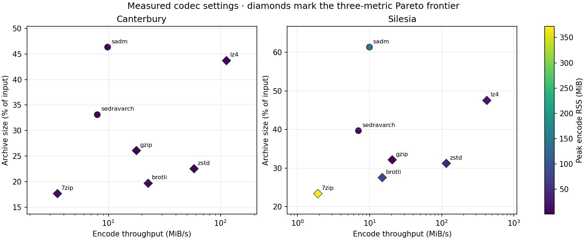

# Benchmarks

The selected SADM profile uses fixed 16 KiB blocks, rANS with explicit model costs, lag prediction and bounded cross-file references. Its builds are isolated from SedravArch 0.7 at `05a1c26662a15b10ce60cc56d568fb410051cfe0`. Settings were measured on Linux x86-64 with AMD EPYC 7763, three available logical CPUs, a two-CPU quota and 8 GiB cgroup memory. Rust 1.100.0 and external codec versions are in the raw records. The selected-profile rerun supplies the SADM measurements below. Other codec measurements come from the full pilot. Small differences in wall time should be interpreted with the shared-runner and split-run caveats.

## Standalone files

Throughput is total original bytes divided by the sum of per-file median wall times. Peak memory is the maximum per-process encode RSS over samples and repetitions. The machine summary also includes CPU time and decode RSS. Every file is archived on its own, so SADM cross-file references cannot help.

| Codec | Canterbury bytes | Encode / decode MiB/s | Encode peak KiB | Silesia bytes | Encode / decode MiB/s | Encode peak KiB |
|---|---:|---:|---:|---:|---:|---:|
| SADM selected | 1,303,197 | 9.84 / 34.58 | 3,484 | 130,138,035 | 9.84 / 64.84 | 135,104 |
| SedravArch Balanced | 932,020 | 7.96 / 42.10 | 3,480 | 84,255,521 | 6.98 / 44.27 | 11,004 |
| 7-Zip LZMA2 level 5 | 497,024 | 3.51 / 44.75 | 15,236 | 49,608,648 | 1.90 / 77.84 | 380,804 |
| Zstandard level 3 | 634,602 | 58.06 / 81.97 | 4,096 | 66,216,569 | 115.43 / 376.94 | 41,472 |
| Brotli level 6 | 555,299 | 22.61 / 105.16 | 6,576 | 58,441,679 | 14.88 / 190.66 | 83,948 |
| gzip level 6 | 733,662 | 17.75 / 92.80 | 1,024 | 68,227,893 | 20.43 / 128.41 | 1,152 |
| LZ4 level 1 | 1,229,454 | 112.70 / 104.81 | 1,920 | 100,934,427 | 419.23 / 541.04 | 25,360 |

Canterbury totals 2,810,784 input bytes and Silesia totals 211,938,580. SADM archives were 39.8% and 54.5% larger than SedravArch respectively. SADM is outside the measured encode Pareto frontier in both suites. The frontier minimizes bytes, median-total wall time and peak RSS jointly. It applies to the tested command settings. [Raw pilot](results/pilot.json) · [Selected SADM runs](results/selected.json) · [Merged machine summary](results/selected-summary.json)

## Version families and selective extraction

The synthetic family has three versions totaling 786,455 bytes. The zlib family uses three actual revisions of one source file. The SADM selected row for zlib is the fixed-block ablation measured with the optimized encoder. Extraction times are the median for the third member and include opening the archive.

| Setting | Synthetic archive bytes | Third member ms | zlib archive bytes | Third member ms |
|---|---:|---:|---:|---:|
| SADM fixed blocks | 263,316 | 4.12 | 69,253 | 3.03 |
| SADM multiscale | 426,831 | 3.87 | 115,879 | 3.26 |
| SedravArch non-solid | 786,899 | 2.75 | 78,644 | 2.90 |
| 7-Zip solid | 262,765 | 5.57 | 19,017 | 4.10 |
| 7-Zip non-solid | 786,682 | 2.49 | 53,644 | 3.31 |

SADM fixed blocks used 21 exact references and 11 deltas in the synthetic family, and 10 deltas in the zlib family. It reduced archive size versus SedravArch on both inputs. Solid 7-Zip was 551 bytes smaller on the synthetic family and substantially smaller on the zlib family. This is an evidence point for a dependency layer. Both cross-file samples are narrow. Filename and timestamp storage contributes differing overhead to the named containers. [Selected synthetic runs](results/selected.json) · [zlib runs](results/zlib-versions.json)

## Standalone structural probes

All probe round trips were verified. SADM and SedravArch columns are complete archives; the BCJ, preflate and shuffle experiments are independent of SADM's wire format.

| Probe | Direct bytes | Transformed bytes | Compared containers |
|---|---:|---:|---|
| Ordinary x64 PE | 43,480 | 41,712 | XZ, then BCJ + XZ |
| Same PE packed with UPX | 44,880 | 44,892 | XZ, then BCJ + XZ |
| Git x64 ELF | 1,631,800 | 1,503,472 | XZ, then BCJ + XZ |
| DOCX | 15,033 | 10,175 | Zstandard 9, then preflate container |
| PDF | 4,773 | 4,945 | Zstandard 9, then preflate container |
| PNG | 316 | 322 | Zstandard 9, then preflate container |
| Strided u32 values | 29,059 | 1,986 | SADM with one selector byte for each route |

Ordinary zlib recompression at levels 1–9 reproduced the positive control at matching levels. It matched none of the 15 tested DOCX DEFLATE members and did not reproduce the tested PNG IDAT stream. The preflate probe recovered complete inputs byte for byte. Its full output lost to direct Zstandard for the PDF, PNG and ZIP control. [Structural measurements](results/structure.json)

## Encoder optimization

After a screening ablation identified model evaluation as time-intensive, the encoder reused histograms across precisions, used corrected integer reciprocals in rANS transitions and terminated candidates that could no longer beat the incumbent. Five alternating before/after runs on each of three inputs verified identical archive bytes. Median encode CPU time fell from 3.470 to 2.451 s on the Git ELF, 0.123 to 0.091 s on Alice and 0.045 to 0.032 s on packed PE. Git ELF median peak RSS increased from 20,028 to 23,980 KiB in these matched runs. The later policy change lowered the default memory footprint by avoiding multiscale DP. [Paired measurements](results/optimization.json)

A manual limit check encoded, verified and restored 64 MiB byte for byte in fixed-block raw mode. A file one byte larger was rejected before archive creation. In the pilot, selected rerun and actual-version measurements, there were 514 single-file round trips and 138 individual member restorations, all compared against original bytes. The 15 paired optimization cases and structural controls are separate.
